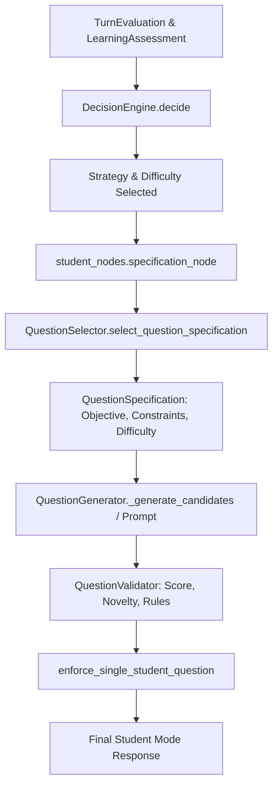

# Curio AI — Phase 4 Master Implementation Report
## Adaptive Difficulty Progression & Evidence-Driven Question Strategies

**Date:** 2026-10-19  
**Repository:** `C:\Users\Vishal S Naik\MyProjects\Curio-AI`  
**Target Environment:** `backend\.venv`  
**Verdict:** **ACCEPT WITH LIMITATIONS**

---

## 1. Executive Summary & Verdict

Phase 4 of Curio's Student Mode roadmap has been implemented and verified. The system now features **adaptive difficulty progression** and **evidence-driven question strategies** anchored in the Feynman Technique. Rather than picking questions by simple rotation or elapsed turn count, Curio diagnoses the learner's actual answer evidence, checks for unresolved misconceptions or gaps, selects from eight grounded pedagogical strategies, bounds difficulty transitions to justified increments/decrements, and translates the strategy and difficulty into concrete, single-question learning specifications and prompts.

- **Verdict:** **ACCEPT WITH LIMITATIONS**
- **Limitations:**
  1. *Per-Concept Turn History:* As established in Phase 3 Step 3.4B, anti-repetition operates primarily on session-level strategy history (`recent_strategy_history`), with active concept preservation in `student_nodes.py`. Fine-grained per-concept turn-by-turn strategy history is not currently tracked as a dedicated list in `ConceptState`.
  2. *Live LLM Validation:* All verification in this phase was conducted using deterministic unit tests with mocked/synthetic evaluations and prompts to ensure strict isolation from shared databases, billable API quotas, and live LLM variance. Full live conversational acceptance with external LLM providers remains recommended for subsequent staging evaluation.

---

## 2. Architecture Audit Findings

Before modifying files, an end-to-end architecture audit was conducted across the backend decision pipeline:

1. **Existing Correct Behavior Preserved:**
   - Evaluator Mode and Teacher Mode state machines remained completely isolated and functional.
   - Step 3.5 single-question enforcement guard (`enforce_single_student_question` in `question_validator.py`) was retained and verified on all candidate generation and fallback paths.
   - Misconception count synchronization (`LearnerModelManager.export_misconception_counts_dict()`) and session state persistence continue to function.

2. **Gaps & Defects Identified Prior to Phase 4:**
   - **Difficulty Progression was Flat/Naive:** In both `DecisionEngine` and `QuestionSelector`, difficulty increases were triggered by `correctness >= 0.80` without checking whether the answer was incomplete (`completeness < 0.70`), vague (`depth < 0.60`), or tainted by active misconceptions.
   - **Incomplete Strategy Set:** Strategies such as `REQUEST_EXAMPLE`, `TEST_EDGE_CASE`, `CHALLENGE_ASSUMPTION`, `CONNECT_CONCEPTS`, and `DEPTH_EXPANSION` were missing from the primary `Strategy` and `LearningStrategy` enums, resulting in generic fallbacks to `VERIFY_UNDERSTANDING` or `PROBE_WHY`.
   - **Strategy-to-Objective Disconnect:** `QuestionSelector._resolve_strategy_objective` only mapped legacy strategies (`PROBE_WHY`, `PROBE_HOW`, `CLARIFY_TERM`, `CHALLENGE_MISCONCEPTION`, `PROBE_MISSING_CONCEPT`). It lacked mappings for edge cases, assumptions, concrete application examples, and architectural concept synthesis.
   - **Specification Fallback Templates:** `QuestionGenerator.construct_specification_fallback` had no branches for `UNDERSTAND_CAUSAL_RELATION`, `EXPLAIN_IN_OWN_WORDS`, `REINFORCE_WEAK_CONCEPT`, or `VERIFY_GAP`, causing fallbacks to default to a generic walking-through question.

---

## 3. Files Changed and Purpose of Each Change

| File | Purpose of Change |
|---|---|
| `backend/app/schemas/common.py` | Extended `LearningStrategy` enum with `REQUEST_EXAMPLE`, `TEST_EDGE_CASE`, `CHALLENGE_ASSUMPTION`, `CONNECT_CONCEPTS`, and `DEPTH_EXPANSION`. |
| `backend/app/ai/schemas.py` | Extended internal `Strategy` enum with the five pedagogical strategies to mirror `LearningStrategy`. |
| `backend/app/ai/decision_engine.py` | Implemented evidence-driven strategy priority hierarchy (Section 5), evidence-constrained difficulty progression rules (Section 4), adaptive anti-repetition preservation for critical needs, and confidence threshold termination offer. |
| `backend/app/ai/question_selector.py` | Aligned `_calculate_next_difficulty` to enforce evidence constraints (incompleteness, vagueness, misconceptions block increase); mapped all 8 strategies to `ObjectiveType` and expected evidence in `_resolve_strategy_objective`. |
| `backend/app/ai/nodes/student_nodes.py` | Updated `specification_node()` so `is_probing_active` includes `REQUEST_EXAMPLE`, `TEST_EDGE_CASE`, `CHALLENGE_ASSUMPTION`, `CONNECT_CONCEPTS`, and `DEPTH_EXPANSION`, preserving `target_concept_override`. |
| `backend/app/ai/prompts/student_prompts.py` | Added targeted scaffolding instruction templates for `REQUEST_EXAMPLE`, `TEST_EDGE_CASE`, `CHALLENGE_ASSUMPTION`, `CONNECT_CONCEPTS`, and `DEPTH_EXPANSION` in `STRATEGY_TEMPLATES`. |
| `backend/app/ai/question_generator.py` | Added explicit specification-driven safe fallbacks for `UNDERSTAND_CAUSAL_RELATION`, `EXPLAIN_IN_OWN_WORDS`, `REINFORCE_WEAK_CONCEPT`, and `VERIFY_GAP` in `construct_specification_fallback`. |
| `backend/tests/ai/test_phase4_adaptive_progression.py` | Created comprehensive deterministic test suite with 26 unit tests covering Scenarios 1–22 and Multi-Turn Sequences A, B, C, and D. |

---

## 4. Difficulty Progression Rules & Thresholds

Curio implements a five-tier pedagogical difficulty model:

- **Level 1 — Definition:** Probes core purpose and foundational terminology (`UNDERSTAND_DEFINITION`).
- **Level 2 — Mechanism:** Probes internal step-by-step process and causality (`UNDERSTAND_MECHANISM`).
- **Level 3 — Application:** Probes concrete scenarios, real-world examples, or use cases (`APPLY_CONCEPT`).
- **Level 4 — Assumptions and Edge Cases:** Probes boundaries, failure limits, extreme inputs, and implicit assumptions (`HANDLE_EDGE_CASE`).
- **Level 5 — Synthesis and Trade-offs:** Probes multi-component coordination, architectural trade-offs, and design justifications (`SYNTHESIZE_CONCEPTS`).

### Progression Invariants & Thresholds

1. **Bounded Delta:** Difficulty delta is bounded to at most $\pm 1$ per turn, clamped strictly in $[1, 5]$.
2. **Criteria for Difficulty Advancement ($+1$):**
   - Correctness $\ge 0.80$
   - Completeness $\ge 0.70$ (a correct but incomplete answer **cannot** advance difficulty)
   - Depth $\ge 0.60$ (vague explanations containing keywords **cannot** advance difficulty)
   - Stuck probability $< 0.30$
   - Active misconceptions count $== 0$ in both current evaluation and `concept_state`
   - Unresolved gap $== \text{False}$ on the active concept
3. **Criteria for Difficulty Regression ($-1$):**
   - Correctness $< 0.40$
   - OR Stuck probability $\ge 0.50$
   - OR Active misconception with correctness $< 0.50$
   - Regresses down to minimum bound of 1.
4. **Maintenance of Current Difficulty ($\Delta = 0$):**
   - Incomplete answers ($0.65 \le \text{correctness} < 0.80$ or $\text{completeness} < 0.70$)
   - Vague answers ($\text{depth} < 0.60$)
   - Active misconceptions under moderate correctness ($0.50 \le \text{correctness} < 0.80$)
   - Off-topic or irrelevant responses (never award mastery or difficulty increases).

---

## 5. Strategy-to-Evidence-to-Objective Mapping

| Strategy | Triggering Evidence | Target Objective | Expected Learner Evidence |
|---|---|---|---|
| `CLARIFY_TERM` | `len(evaluation.undefined_terms) > 0` | `UNDERSTAND_DEFINITION` | Precise definition and plain-language unpacking of the undefined term. |
| `CHALLENGE_MISCONCEPTION` | `len(evaluation.misconceptions) > 0` | `RESOLVE_MISCONCEPTION` | Identifies and resolves the conceptual contradiction via counterexample. |
| `CHALLENGE_ASSUMPTION` | Premise assumption detected or implicit constraint flagged | `HANDLE_EDGE_CASE` | Identifies implicit premises and tests validity under edge conditions. |
| `PROBE_MISSING_CONCEPT` | `len(evaluation.missing_concepts) > 0` | `REINFORCE_WEAK_CONCEPT` / `VERIFY_GAP` | Supplies omitted structural component and explains integration. |
| `REQUEST_EXAMPLE` | Mechanics explained abstractly, needs practical use case | `APPLY_CONCEPT` | Illustrates understanding with a concrete, realistic real-world example. |
| `TEST_EDGE_CASE` | Application understood, probes boundary limits / failures | `HANDLE_EDGE_CASE` | Analyzes behavior under extreme inputs, constraints, and failure modes. |
| `CONNECT_CONCEPTS` | Robust edge-case mastery, probes system trade-offs | `SYNTHESIZE_CONCEPTS` | Synthesizes concept with related components; analyzes trade-offs. |
| `DEPTH_EXPANSION` | Correct but incomplete explanation (`completeness < 0.70`) | `UNDERSTAND_MECHANISM` | Expands depth, detail, and missing dimensions of the mechanism. |
| `PROBE_HOW` | Outcome described without operational mechanism | `UNDERSTAND_MECHANISM` | Walks through step-by-step process flow and internal operations. |
| `PROBE_WHY` | Facts stated without causal rationale or justification | `UNDERSTAND_CAUSAL_RELATION` | Explains underlying causality, theoretical basis, and design rationale. |
| `VERIFY_UNDERSTANDING` | General partial answer fallback | `EXPLAIN_IN_OWN_WORDS` | Verifies intuition by explaining core ideas in learner's own words. |

### Decision Precedence Policy

1. Respect session termination and restored question requirements.
2. Undefined terms blocking foundational understanding (`CLARIFY_TERM`).
3. Critical active misconceptions (`CHALLENGE_MISCONCEPTION`).
4. Unsupported assumptions / unverified premises (`CHALLENGE_ASSUMPTION`).
5. Missing structural components / prerequisite gaps (`PROBE_MISSING_CONCEPT`).
6. Application example gaps (`REQUEST_EXAMPLE`).
7. Boundary conditions & edge cases (`TEST_EDGE_CASE`).
8. System synthesis and trade-offs (`CONNECT_CONCEPTS`).
9. Incomplete explanation depth (`DEPTH_EXPANSION`).
10. Operational mechanism gaps (`PROBE_HOW`).
11. Causal reasoning gaps (`PROBE_WHY`).
12. Tier progression on strong evidence (`INCREASE_DIFFICULTY` / tier-specific probe).
13. General verification fallback (`VERIFY_UNDERSTANDING`).

### Anti-Repetition Exception Policy

Consecutive repetition of probing strategies is alternated to avoid monotonous questioning (e.g., `PROBE_WHY` $\rightarrow$ `PROBE_HOW`; `PROBE_HOW` $\rightarrow$ `VERIFY_UNDERSTANDING`; `REQUEST_EXAMPLE` $\rightarrow$ `DEPTH_EXPANSION`).  
**Crucial pedagogical exception:** Anti-repetition **never** suppresses `CLARIFY_TERM` while terms remain undefined, nor `CHALLENGE_MISCONCEPTION` while an active misconception remains unresolved.

---

## 6. Question Specification & Candidate Generation Flow



1. **Downstream Propagation:** The selected strategy and difficulty directly set `spec.difficulty`, `spec.learning_objective.objective_type`, and `spec.generation_constraints`.
2. **Prompt Scaffolding:** `build_candidate_generation_prompt` injects the pedagogical objective, exact difficulty level label, expected evidence, and anti-repetition negative constraints into the LLM prompt.
3. **Specification-Driven Fallbacks:** If LLM candidates fail validation or timeout, `QuestionGenerator.construct_specification_fallback` generates a clean, single-question fallback strictly customized to the target concept and objective type, avoiding any hardcoded or ungrounded questions.
4. **Final Single-Question Guard:** `enforce_single_student_question` guarantees that the returned output contains exactly one question mark and no answer leaks, preserving any leading conversational acknowledging prefix.

---

## 7. State Integrity & Persistence Compatibility

- `DecisionEngine` evaluates current turn assessment state rather than stale state.
- `LearnerModelManager.update_from_evaluation()` deterministically records attempts, evidence count, mastery scores, active misconceptions, and unresolved gaps.
- `misconception_counts` are exported as a dictionary for `SessionState` synchronization as established in Step 3.4A.
- `recent_strategy_history` records strategies actually selected and passed to the user, preventing recording of unselected candidates.
- Legacy session states with missing strategy history or active concepts are handled defensively with safe defaults.
- No database migrations were required; all state attributes utilize existing columns and models.

---

## 8. Test Execution Evidence & Observed Counts

All tests were executed using the local isolated virtual environment (`backend\.venv\Scripts\python.exe -m pytest`). No live database calls or shared Supabase connections were made.

### Test Command 1: Primary Phase 4 Suite
```powershell
backend\.venv\Scripts\python.exe -m pytest backend/tests/ai/test_phase4_adaptive_progression.py -v
```
**Results:** **26 passed, 0 failed, 0 errors, 2 warnings** (in 2.18s)

### Test Command 2: Combined Regression Suite
```powershell
backend\.venv\Scripts\python.exe -m pytest backend/tests/ai/test_phase4_adaptive_progression.py backend/tests/ai/test_student_final_question_enforcement.py backend/tests/ai/test_decision_engine.py backend/tests/ai/test_question_selector.py -v
```
**Results:** **62 passed, 0 failed, 0 errors, 2 warnings** (in 2.33s)

### Test Command 3: Related AI Architecture & Schema Suite
```powershell
backend\.venv\Scripts\python.exe -m pytest backend/tests/ai/test_learner_model.py backend/tests/ai/test_schemas.py backend/tests/ai/test_student_nodes_turn_interpretation.py backend/tests/ai/test_student_assessment_question_wiring.py backend/tests/ai/test_generator_validator.py -v
```
**Results:** **32 passed, 0 failed, 0 errors, 2 warnings** (in 2.58s)

### Total Verified Test Summary
- **Total Tests Run Across Primary & Regression Suites:** **94 tests**
- **Passed:** **94**
- **Failed:** **0**
- **Skipped:** **0**
- **Errors:** **0**

---

## 9. Multi-Turn Simulation Results

Four deterministic multi-turn sequences were evaluated in `test_phase4_adaptive_progression.py`:

### Sequence A — Progressive Understanding
- **Turn 1 (Initial):** User starts session. Curio asks foundational definition question (`ASK_FOUNDATION`, Difficulty 1). Objective: `UNDERSTAND_DEFINITION`.
- **Turn 2 (Partial Answer):** User answers with low completeness (`0.50`). Curio detects incomplete explanation and holds difficulty at 1, selecting `DEPTH_EXPANSION` / `PROBE_HOW` to probe process steps.
- **Turn 3 (Mechanism Clear):** User provides detailed mechanism (`mid = low + (high-low)//2`). Curio recognizes high correctness (`0.88`), completeness (`0.80`), and depth (`0.75`), advancing difficulty boundedly to 2.
- **Turn 4 (Application):** User explains practical application in log search. Curio advances difficulty to 3, requesting a concrete boundary scenario (`REQUEST_EXAMPLE`).

### Sequence B — Persistent Misconception
- **Turn 1 (Misconception Introduced):** Student claims binary search works on unsorted lists. Curio detects misconception, clamps difficulty to 2, and selects `CHALLENGE_MISCONCEPTION`.
- **Turn 2 (Misconception Persists):** Student doubles down on the error. Curio's anti-repetition rule recognizes the critical active misconception, overriding suppression to persist with `CHALLENGE_MISCONCEPTION` while preventing premature mastery increase.

### Sequence C — Strong but Incomplete Explanation
- **Turn 1:** Student provides an articulate, confident explanation that omits practical application dimensions (`completeness = 0.65`).
- **Turn 2:** Curio refuses to falsely advance to Level 4/5 based on vocabulary alone. It selects `DEPTH_EXPANSION` / `REQUEST_EXAMPLE` at Difficulty 2 to verify grounding before advancing.

### Sequence D — Repetition & Recovery
- **Turn 1:** Strategy history shows `PROBE_WHY` was just used.
- **Turn 2:** Student provides another causal explanation. To avoid consecutive strategy repetition, Curio shifts strategy to `PROBE_HOW`.
- **Turn 3 (Final Enforcement):** The resulting response passes through `enforce_single_student_question()`, confirming that leading conversational acknowledging remarks are preserved while ensuring exactly one question mark exists.

---

## 10. Scope & Safety Confirmations

1. **Frontend:** Zero modifications. No frontend files or API contracts altered.
2. **Database Migrations:** Zero migrations created or executed.
3. **Database Writes:** Zero writes to Supabase, staging, or production databases. All tests executed with in-memory fixtures.
4. **Answer Leakage & Voice:** Verified across all objective fallbacks. Output adheres strictly to the curious Feynman student persona.
5. **Git Hygiene:** Only the 7 intended backend code files were modified and 1 test file added.

---

## 11. Conclusion & Recommended Next Actions

Phase 4 is complete, verified, and ready for review.

**Recommended Next Actions:**
1. Review and accept Phase 4 implementation report.
2. Proceed to staging / live LLM acceptance testing for qualitative student voice evaluation across the new strategies.
3. Prepare for Phase 5 (Evaluator Mode synthesis & student mastery timeline).
