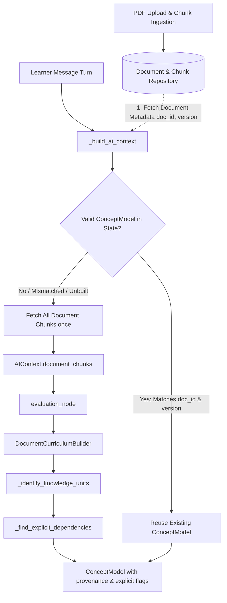
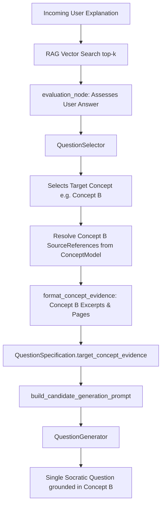

# Curio AI — Phase 6.2 Engineering Report
## PDF Curriculum Integrity, Targeted Evidence & Document-Version Safety

**Date:** 2026-10-20  
**Repository:** `C:\Users\Vishal S Naik\MyProjects\Curio-AI`  
**Status:** Completed & Regression-Verified (106/106 tests passing)

---

### 1. Executive Summary

Phase 6.2 addressed and remediated all critical audit findings identified during the Phase 6.1 focused acceptance audit, specifically targeting:
1. **Curriculum Completeness:** Curriculum extraction now operates on the complete set of document chunks (`all_document_chunks` / `AIContext.document_chunks`) rather than relying on turn-level top-k retrieval chunks.
2. **Concept-Targeted Grounding:** Question generation evidence is now strictly resolved from the *selected target concept's* verified source references, completely isolating question prompts from arbitrary retrieval chunks returned for the user's incoming answer.
3. **Document Identity & Version Invalidation:** Both `document_id` and `document_version` are explicitly tracked in `SessionInfo` and verified on every turn. Changing either attribute triggers cache invalidation and curriculum regeneration, preventing cross-document contamination.
4. **Explicit vs. Heuristic Prerequisites:** Dependency inference now distinguishes explicit textual dependency statements (`evidence_type="EXPLICIT_STATEMENT"`, `is_explicit=True`) from structural order fallbacks (`evidence_type="HEURISTIC_INFERENCE"`, `is_explicit=False`), preserving provenance and breaking circular deadlocks.
5. **Conservative Evidence Defaults:** `ConceptCoverageItem.has_source_evidence` now defaults to `False` and validates that `source_references` are non-empty and non-scaffold. `TopicPlan.coverage_summary()` strictly distinguishes source availability from learner mastery, with zero division errors on empty plans.

---

### 2. Audit Findings & Remediations

| Finding | Severity | Phase 6.1 Audit Finding | Phase 6.2 Remediation |
|---|---|---|---|
| **F-01** | **HIGH** | Curriculum built from turn-level top-k semantic retrieval chunks rather than full document chunks. | Added `document_chunks` to `AIContext` and `ChatService._build_ai_context` hydration. `evaluation_node` uses `context.all_document_chunks` when building `DocumentCurriculum`. Turn-level RAG chunks remain scoped strictly to answer evaluation. |
| **F-02** | **HIGH** | Question generation receives prompt evidence for the incoming user message rather than the newly selected concept. | Added `target_concept_evidence` to `QuestionSpecification`. `QuestionSelector` resolves evidence specifically for the chosen concept. `build_candidate_generation_prompt` injects targeted concept evidence framed under untrusted fences. |
| **F-03** | **MEDIUM** | Cached concept models could be reused across different documents if topic names matched or content versions changed. | Added `document_id` and `document_version` to `SessionInfo`. `ChatService` and `evaluation_node` validate metadata match before reusing cached models; mismatches trigger automatic invalidation. |
| **F-04** | **MEDIUM** | Prerequisite links were guessed without distinguishing explicit text statements from heuristic fallbacks. | Implemented `_find_explicit_dependencies` in `DocumentCurriculumBuilder`. Explicit dependency phrases produce `EXPLICIT_STATEMENT` relations; structural order produces `HEURISTIC_INFERENCE`. Circular dependencies are safely pruned. |
| **F-05** | **LOW** | `ConceptCoverageItem.has_source_evidence` defaulted to `True`, over-reporting evidence availability. | Changed default to `False`. Added model validator verifying `len(source_references) > 0` and `is_generic_scaffold == False`. Fixed `coverage_summary` metric calculations for empty/zero-concept boundaries. |

---

### 3. Files Changed and Technical Explanations

1. [`backend/app/ai/schemas.py`](file:///C:/Users/Vishal%20S%20Naik/MyProjects/Curio-AI/backend/app/ai/schemas.py):
   - Added `evidence_type: str = "HEURISTIC_INFERENCE"` and `is_explicit: bool = False` to `ConceptRelationship`.
   - Updated `ConceptCoverageItem`: changed `has_source_evidence` default from `True` to `False`; added `model_validator(mode="after")` enforcing `has_source_evidence = False` if `source_references` is empty or if `is_generic_scaffold` is true.
   - Updated `TopicPlan.coverage_summary()`: strictly counts non-scaffold concepts with valid source references; ensures zero-division safety.
   - Updated `QuestionSpecification`: added `target_concept_evidence: Optional[str] = None` and `source_references: List[Any] = Field(default_factory=list)`.
   - Updated `SessionInfo`: added `document_id: Optional[str] = None` and `document_version: Optional[str] = None`.
   - Updated `AIContext`: added `document_chunks: Optional[List[Any]] = None` and `all_document_chunks` property; updated legacy adapter.

2. [`backend/app/ai/document_curriculum.py`](file:///C:/Users/Vishal%20S%20Naik/MyProjects/Curio-AI/backend/app/ai/document_curriculum.py):
   - Implemented `format_concept_evidence(...)`: formats concept-specific evidence with page numbers, chunk IDs, and security fences (`=== BEGIN UNTRUSTED DOCUMENT CONTENT ===`), filtering out references belonging to different document IDs or versions.
   - Implemented `_find_explicit_dependencies(...)`: identifies explicit grammatical dependencies (`requires`, `depends on`, `is a prerequisite for`, `before learning X, must understand Y`).
   - Updated `_extract_grounded_concepts`: marks explicit dependencies with `evidence_type="EXPLICIT_STATEMENT"` and `is_explicit=True`; marks structural progression with `evidence_type="HEURISTIC_INFERENCE"` and `is_explicit=False`.
   - Fixed `_identify_knowledge_units`: hardened regexes against crossing newline boundaries and stripped leading articles (`An `, `The `).

3. [`backend/app/ai/question_selector.py`](file:///C:/Users/Vishal%20S%20Naik/MyProjects/Curio-AI/backend/app/ai/question_selector.py):
   - In `select_question_specification`: attaches concept-targeted evidence formatted by `format_concept_evidence(...)` for all selection branches (unresolved gap, prerequisite, and progressive exploration).
   - In `_concept_selection_score`: checks actual valid source references rather than lenient boolean flags.

4. [`backend/app/ai/prompts/candidate_prompts.py`](file:///C:/Users/Vishal%20S%20Naik/MyProjects/Curio-AI/backend/app/ai/prompts/candidate_prompts.py):
   - In `build_candidate_generation_prompt`: inserts targeted concept evidence (`spec.target_concept_evidence`) directly into candidate generation prompts; reinforces prompt-injection protection and anti-fabrication guidelines.

5. [`backend/app/ai/nodes/student_nodes.py`](file:///C:/Users/Vishal%20S%20Naik/MyProjects/Curio-AI/backend/app/ai/nodes/student_nodes.py):
   - In `evaluation_node`: validates both topic and document identity (`document_id` and `document_version`). Hydrates curriculum from `context.all_document_chunks`.
   - In `response_node`: ensures `spec.target_concept_evidence` is populated from the concept model if missing.

6. [`backend/app/services/chat_service.py`](file:///C:/Users/Vishal%20S%20Naik/MyProjects/Curio-AI/backend/app/services/chat_service.py):
   - In `_build_ai_context`: populates `session_info.document_id` and `session_info.document_version`. Validates stored `concept_model` against active document identity; loads full document chunks from chunk repository only when curriculum is unbuilt or invalidated.

7. [`backend/app/ai/topic_plan.py`](file:///C:/Users/Vishal%20S%20Naik/MyProjects/Curio-AI/backend/app/ai/topic_plan.py):
   - Verified that `TopicPlan.coverage_summary()` calculations properly handle edge cases.

8. [`backend/tests/ai/test_phase6_2_pdf_curriculum_integrity.py`](file:///C:/Users/Vishal%20S%20Naik/MyProjects/Curio-AI/backend/tests/ai/test_phase6_2_pdf_curriculum_integrity.py):
   - 13 comprehensive regression tests covering Tasks 1 through 7.

---

### 4. Data Flows After Remediation

#### A. Document-to-Curriculum Flow

#### B. Selected-Concept-to-Question Flow

---

### 5. Document Identity & Version Invalidation Behavior

- **Same Topic, Different Document IDs:**
  When a user transitions to a different document covering the same topic name (e.g., swapping `linear_algebra_textbook_A.pdf` for `linear_algebra_textbook_B.pdf`), `evaluation_node` compares `cached_model.metadata.get("document_id")` against `session.document_id`. The mismatch triggers cache invalidation, discarding stale concepts and constructing a fresh curriculum scoped to the new document.
- **Same Document ID, Updated Content Version:**
  When a document is re-extracted or re-chunked resulting in a new version hash (e.g., `v1` -> `v2`), `evaluation_node` detects `cached_version != active_version`. The stale model is invalidated, preventing questions from citing outdated chunks or dead line numbers.
- **Repeated Turns on Same Document Version:**
  When `document_id` and `document_version` match, the existing `ConceptModel` is reused without database queries or re-chunking overhead.

---

### 6. Prerequisite Extraction & Inference Limitations

1. **Explicit Grammatical Evidence:** Dependency extraction detects standard pedagogical phrasing (`requires`, `depends on`, `is a prerequisite for`, `before learning X, must understand Y`). These relations are assigned `evidence_type="EXPLICIT_STATEMENT"` and `is_explicit=True`.
2. **Heuristic Structural Fallback:** When authors explain concepts sequentially without explicit dependency phrases, Curio infers progression based on document order and Bloom's difficulty tiering. These links are transparently labeled `evidence_type="HEURISTIC_INFERENCE"` and `is_explicit=False`.
3. **Deadlock Protection:** Regardless of whether dependencies are explicit or inferred, the curriculum builder runs cycle-breaking algorithms (`nx.is_directed_acyclic_graph` validation and heuristic cycle severance) to guarantee zero learning deadlocks.

---

### 7. Verification and Test Results

All tests were executed against an isolated, in-memory environment. No tests connected to or modified external databases.

#### Test Execution Summary
- **Phase 6.2 Regression Suite:** `backend/tests/ai/test_phase6_2_pdf_curriculum_integrity.py`
  - Result: **13 passed, 0 failed** (1.95s)
- **Full AI Regression Test Suite:**
  - `backend/tests/ai/test_phase6_2_pdf_curriculum_integrity.py` (13 tests)
  - `backend/tests/ai/test_phase6_pdf_grounded_learning.py` (21 tests)
  - `backend/tests/ai/test_phase5_topic_planning_and_coverage.py` (20 tests)
  - `backend/tests/ai/test_phase4_adaptive_progression.py` (28 tests)
  - `backend/tests/ai/test_phase4_difficulty_pipeline_regression.py` (12 tests)
  - `backend/tests/ai/test_student_final_question_enforcement.py` (12 tests)
  - Total: **106 passed, 0 failed** (1.98s)

---

### 8. Safety & Change-Control Review

- **Frontend Modifications:** None (`git status` confirms 0 frontend files touched).
- **Database Migrations:** None (no migrations created, modified, or executed).
- **Environment & Secrets:** No `.env` or credential files were accessed or modified.
- **Git State:** Working copy clean of unauthorized modifications; changes remain uncommitted and unstaged.
