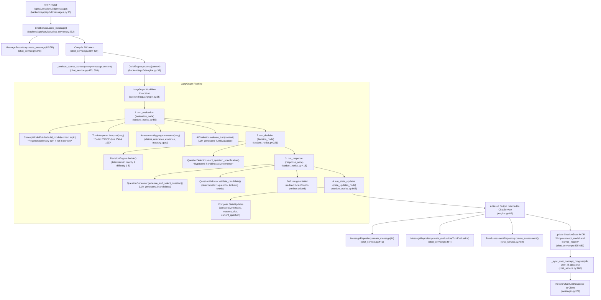
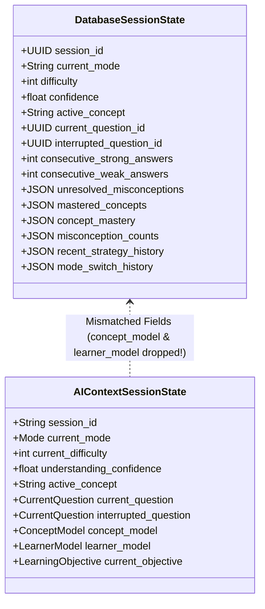
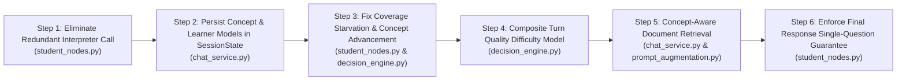

# CURIO AI — STUDENT MODE
## Phase 1: Comprehensive Read-Only Architecture & Behavior Audit Report

**Date:** 2026-10-19  
**Repository:** `C:\Users\Vishal S Naik\MyProjects\Curio-AI`  
**Target:** Student Mode (Pedagogical Core, Engine Pipeline, Evaluation, Coverage, Grounding, and Persistence)  
**Execution Mode:** STRICTLY READ-ONLY (No code, configurations, database, or git state modified)

---

## A. Executive Summary

### Overall Assessment
Curio AI’s Student Mode possesses an ambitious and sophisticated theoretical architecture: it rejects passive question answering and chatbot tropes in favor of the Feynman Technique—positioning Curio as a curious, skeptical student and the learner as the teacher. The codebase contains extensive modeling for concept graphs, Bayesian-style learner mastery updates, multi-stage answer evaluation (claim extraction, relevance filtering, and misconception gating), deterministic strategy selection, and bounded difficulty transitions.

However, a rigorous read-only code trace reveals a fundamental disconnect between **the architectural design expressed in the AI subpackage** and **what the backend actually executes and persists across turns in runtime production**.

### Strongest Existing Capabilities
1. **Answer Intelligence Relevance & Misconception Gating (`backend/app/ai/answer_intelligence/`)**: Unlike typical LLM tutoring bots that blindly accept any reply, Curio has an explicit multi-stage assessment aggregator with semantic relevance checks (`relevance_model.py`) and a strict `MasteryGate` (`mastery_gate.py`). Irrelevant, off-topic, or trivial acknowledgement answers ("ok", "makes sense") are deterministically prevented from granting mastery or advancing concepts.
2. **Deterministic Strategy and State Machine Boundaries (`backend/app/ai/decision_engine.py`)**: The system enforces that pedagogical decisions (whether to clarify a term, probe a mechanism, challenge a misconception, or transition to Teacher Mode) are determined deterministically by Python business logic rather than unconstrained prompt completions.
3. **Candidate Generation & Validation Pipeline (`backend/app/ai/question_generator.py` & `question_validator.py`)**: Rather than accepting whatever single string an LLM generates, Student Mode produces 3 candidate questions, runs deterministic validation (checking word count, single-question constraints, lecturing phrases, and novelty against recent turns), retries once with tightened constraints if all fail, and falls back to a specification-driven template if necessary.
4. **Clean Decoupled Engine Contract (`backend/app/ai/engine.py`)**: The runtime boundary `AIContext -> CurioEngine.process() -> AIResult` is clean, strictly typed, and completely hides the internal LangGraph state machine from the FastAPI service layer.

### Most Consequential Verified Gaps
1. **Critical State Amnesia Across Turns (P1)**: While `ConceptModel` and `LearnerModel` are constructed in memory within the AI engine, **neither model is persisted in PostgreSQL or rehydrated by `ChatService`** (`backend/app/services/chat_service.py:373-390`). The database table `session_states` has no column for `ConceptModel`. Consequently, on **every single user turn**, the system enters `evaluation_node` with `context.current_state.concept_model = None`, triggering an LLM re-generation of the entire topic concept graph (`builder.build_model(context.topic)`). Because LLM generation is non-deterministic, concept IDs, names, and prerequisite structures mutate from turn to turn, breaking concept mastery tracking and continuity.
2. **Coverage Starvation & Topic Entrapment (P1)**: The system lacks a proactive topic-driven coverage manager. When the user explains a topic well, `decision_engine.py:568` selects `PROBE_WHY` on the active concept. When `PROBE_WHY` is active, `student_nodes.py:381-388` sets `concept_target = context.active_concept`, which explicitly instructs `QuestionSelector` to stay on the same concept and bypass `_select_next_concept_node`. Curio becomes trapped probing the same concept indefinitely. If the user never mentions an essential subtopic (e.g., time complexity in binary search), Curio never introduces it.
3. **PDF-Grounded Learning is Blind to Document Structure (P1)**: For document-backed sessions, `_retrieve_source_context` in `chat_service.py:423` executes vector retrieval using only the user's latest message (`query=message_in.content`). If the user says "I don't know" or "can you explain?", vector search retrieves chunks semantically close to "I don't know". Furthermore, `ConceptModelBuilder.build_model(context.topic)` is invoked with only the string topic title, never receiving document chunks, table of contents, or structural summaries. Curio has zero structured knowledge of what is actually inside the PDF.
4. **Execution Redundancy and Provider Overhead (P2)**: In `student_nodes.py:155-198`, `TurnInterpreter(provider).interpret(...)` is called **twice consecutively** on the exact same message with the exact same arguments in the exact same function. Furthermore, `evaluation_node` makes up to 4 separate LLM calls per turn (two interpretations, one evaluator turn evaluation, and one concept model generation), introducing severe latency and fragility.
5. **Single-Question Rule Leaks via Prefixes and Fallbacks (P2)**: While candidate questions are validated for `count("?") == 1`, `response_node` in `student_nodes.py:558, 561` prepends redirection and clarification prefixes (`"That doesn't address the question yet. Let's focus on..."`), and Teacher mode restore strings append preambles. No final validation or post-processing sanitizes the final composite string before it is returned as `AIResponse.content`.

### Incremental Feasibility & Main Blocker
The current architecture **is highly suitable for incremental improvement**. It does not require a rewrite. The foundations (Pydantic schemas, LangGraph node pipeline, DecisionEngine, QuestionSelector, AssessmentAggregator) are well-architected.
The **main blocker** to achieving Curio's intended behavior is **the absence of persistent learning-plan state and an active coverage coordinator**: Curio reacts locally turn-by-turn to whatever string the user typed, rather than navigating an explicit, persisted curriculum graph that systematically probes unassessed objectives.

---

## B. Repository and Working-Tree Baseline

- **Repository Path:** `C:\Users\Vishal S Naik\MyProjects\Curio-AI`
- **Active Workspace URI:** `c:\Users\Vishal S Naik\MyProjects\Curio-AI` -> `joshi-chinmay-016/Curio-AI`
- **Current Git Branch:** `backend`
- **Latest Commit Hash & Subject:** `904f68b` (*"increase auth timeout for cloud db latency and suppress pydantic model warning"*)
- **Previous Commits in History:**
  - `ecc4c3d` Merge branch 'dev' into backend
  - `5653c29` Merge pull request #21 from joshi-chinmay-016/ft/voice
  - `8bffaa4` docs(voice): document STT and TTS setup and deployment
  - `8f92a64` test(voice): validate voice chat integration and document deployment
- **Working-Tree Status:** Completely clean (`git status -s` yielded empty output; no staged or unstaged modifications).
- **Untracked / Scratch Files Noted:** `scratch_check_db.py`, `backend/check_dev_db.py`, `backend/check_turn_assessments.py`, `backend/verify_test_db.py`.
- **Files Inspected During Audit:**
  - Backend API: `backend/app/api/v1/sessions.py`, `backend/app/api/v1/messages.py`
  - Backend Services: `backend/app/services/chat_service.py`, `backend/app/services/session_service.py`
  - AI Engine Core: `backend/app/ai/engine.py`, `backend/app/ai/graph.py`, `backend/app/ai/nodes/student_nodes.py`
  - Pedagogical Policies: `backend/app/ai/decision_engine.py`, `backend/app/ai/question_selector.py`, `backend/app/ai/question_generator.py`, `backend/app/ai/question_validator.py`
  - Knowledge & Learner Models: `backend/app/ai/concept_model.py`, `backend/app/ai/learner_model.py`, `backend/app/ai/turn_interpreter.py`, `backend/app/ai/evaluator.py`, `backend/app/ai/scoring.py`
  - Answer Intelligence: `backend/app/ai/answer_intelligence/assessment_aggregator.py`, `backend/app/ai/answer_intelligence/prompt_augmentation.py`, `backend/app/ai/answer_intelligence/mastery_gate.py`
  - Prompts & Schemas: `backend/app/ai/schemas.py`, `backend/app/ai/prompts/student_prompts.py`, `backend/app/ai/prompts/candidate_prompts.py`, `backend/app/ai/prompts/evaluator_prompts.py`
  - Database Models: `backend/app/models/session.py`, `backend/app/models/user.py`, `backend/app/models/message.py`
  - Test Suite: `backend/tests/conftest.py`, `backend/tests/ai/test_phase1_student_mode.py`, `backend/tests/ai/test_live_validation.py`, `backend/tests/ai/test_concept_session_lifecycle.py`, `backend/tests/ai/test_grounded_student_teacher_mode.py`, `backend/tests/ai/test_groq_provider.py`
- **Confirmation of Zero Changes:** **Nothing was modified, created, moved, or deleted during discovery.** No migrations were run, no packages installed, and no external requests made.

---

## C. Actual Execution Flow

Tracing the incoming user explanation through the physical codebase from HTTP endpoint to persisted next question:



### Detailed Stage-by-Stage Breakdown

| Stage | File Path & Function | Lines | Inputs & Outputs | State Read / Modified | Nature | Exception & Fallback |
| :--- | :--- | :--- | :--- | :--- | :--- | :--- |
| **1. Request Entry** | [messages.py](file:///c:/Users/Vishal%20S%20Naik/MyProjects/Curio-AI/backend/app/api/v1/messages.py#L15-L28): `send_message` | 15–28 | In: `session_id`, `MessageCreate`<br/>Out: `ChatTurnResponse` | None | Deterministic | Catches `ValueError` -> 404, generic `Exception` -> 500 |
| **2. Auth & Session Resolution** | [chat_service.py](file:///c:/Users/Vishal%20S%20Naik/MyProjects/Curio-AI/backend/app/services/chat_service.py#L240-L246): `send_message` | 240–246 | In: `session_id`, `user_id`<br/>Out: `db_session` | Reads `sessions` & `session_states` | Deterministic | Raises `ValueError` if session not found or user does not own it |
| **3. Message Persistence (User)** | [chat_service.py](file:///c:/Users/Vishal%20S%20Naik/MyProjects/Curio-AI/backend/app/services/chat_service.py#L248-L249): `send_message` | 248–249 | In: `MessageCreate`<br/>Out: `user_msg` (DB model) | Inserts row into `messages` table | Deterministic | Relies on SQLAlchemy session transaction |
| **4. Context Hydration** | [chat_service.py](file:///c:/Users/Vishal%20S%20Naik/MyProjects/Curio-AI/backend/app/services/chat_service.py#L250-L420): `send_message` | 250–420 | In: `db_session`, `db_history`<br/>Out: `AIContext` | Reads DB state; constructs in-memory `AIContext` | Deterministic | Defaults `concept_model=None`, `learner_model=None`, `difficulty=1` |
| **5. RAG Retrieval** | [chat_service.py](file:///c:/Users/Vishal%20S%20Naik/MyProjects/Curio-AI/backend/app/services/chat_service.py#L423-L432): `_retrieve_source_context` | 423–432, 880–950 | In: `query=message_in.content`<br/>Out: `dict` with top-5 chunks | Queries pgvector store via `RetrievalService` | Deterministic / Semantic | Returns `status="no_results"` or `status="error"` on `RetrievalError` |
| **6. Engine Invocation** | [engine.py](file:///c:/Users/Vishal%20S%20Naik/MyProjects/Curio-AI/backend/app/ai/engine.py#L38-L97): `CurioEngine.process` | 38–97 | In: `AIContext`<br/>Out: `AIResult` | Instantiates graph state | Orchestration | If graph output missing `state_updates`, constructs baseline updates |
| **7. Evaluation Node** | [student_nodes.py](file:///c:/Users/Vishal%20S%20Naik/MyProjects/Curio-AI/backend/app/ai/nodes/student_nodes.py#L55-L318): `evaluation_node` | 55–318 | In: `AIContext`<br/>Out: `evaluation`, `assessment`, `interpretation`, `concept_model`, `learner_model` | Hydrates or regenerates `ConceptModel`; reads/updates in-memory `LearnerModel` | Mixed (LLM + Deterministic) | Calls `interpreter.interpret` twice (lines 156 & 193). Falls back to defensive defaults on failure |
| **8. Decision Node** | [student_nodes.py](file:///c:/Users/Vishal%20S%20Naik/MyProjects/Curio-AI/backend/app/ai/nodes/student_nodes.py#L321-L414): `decision_node` | 321–414 | In: `context`, `evaluation`, `interpretation`, `assessment`<br/>Out: `decision`, `spec` | Computes next mode, strategy, difficulty, and QuestionSpecification | Strictly Deterministic | If initial turn, sets `ASK_FOUNDATION` at difficulty 1 |
| **9. Response Node** | [student_nodes.py](file:///c:/Users/Vishal%20S%20Naik/MyProjects/Curio-AI/backend/app/ai/nodes/student_nodes.py#L416-L603): `response_node` | 416–603 | In: `spec`, `context`, `decision`<br/>Out: `AIResponse` | Calls `QuestionGenerator` -> `QuestionValidator`; adds prefixes | Mixed (LLM + Deterministic) | 1 retry with tightened constraints; fallback to specification template |
| **10. State Updates Node** | [student_nodes.py](file:///c:/Users/Vishal%20S%20Naik/MyProjects/Curio-AI/backend/app/ai/nodes/student_nodes.py#L605-L835): `state_updates_node` | 605–835 | In: `state` dict<br/>Out: `StateUpdates` | Computes streaks, mastery dictionary, question IDs | Deterministic | Bounded clamping of scores and difficulty |
| **11. Response Persistence (AI)** | [chat_service.py](file:///c:/Users/Vishal%20S%20Naik/MyProjects/Curio-AI/backend/app/services/chat_service.py#L441-L446): `send_message` | 441–446 | In: `response.content`<br/>Out: `ai_msg` (DB model) | Inserts AI row into `messages` table | Deterministic | Relies on SQLAlchemy session transaction |
| **12. Turn Evaluation Persistence** | [chat_service.py](file:///c:/Users/Vishal%20S%20Naik/MyProjects/Curio-AI/backend/app/services/chat_service.py#L449-L464): `send_message` | 449–464 | In: `TurnEvaluationResponse`<br/>Out: `TurnEvaluation` row | Inserts into `turn_evaluations` table | Deterministic | Clamps floats to [0.0, 1.0] |
| **13. Turn Assessment Persistence** | [chat_service.py](file:///c:/Users/Vishal%20S%20Naik/MyProjects/Curio-AI/backend/app/services/chat_service.py#L466-L493): `send_message` | 466–493 | In: JSON dumps of assessment, interpretation, objective, spec | Inserts into `turn_assessments` table | Deterministic | Skips if all assessment components are None |
| **14. State Persistence (SessionState)** | [chat_service.py](file:///c:/Users/Vishal%20S%20Naik/MyProjects/Curio-AI/backend/app/services/chat_service.py#L495-L685): `send_message` | 495–685 | In: `StateUpdates`<br/>Out: Updated `db_session.state` | Updates `session_states` row | Deterministic | **CRITICAL:** `concept_model` and `learner_model` are NOT saved to DB |
| **15. Progress Sync** | [chat_service.py](file:///c:/Users/Vishal%20S%20Naik/MyProjects/Curio-AI/backend/app/services/chat_service.py#L966-L1034): `_sync_user_concept_progress` | 966–1034 | In: `updates.concept_mastery`, `updates.difficulty` | Upserts `user_concept_progress` rows | Deterministic | Swallows exceptions on sync failure to prevent turn abortion |

---

## D. Student Mode Requirement Matrix

| Requirement | Current Implementation | Evidence | Status | Consequence |
| :--- | :--- | :--- | :--- | :--- |
| **3.1 Answer-driven questioning** | Answer Intelligence extracts claims, evaluates relevance, and matches evidence to expected items. DecisionEngine picks `CLARIFY_TERM` for undefined terms, `PROBE_WHY`/`HOW` for gaps. | [decision_engine.py:530-575](file:///c:/Users/Vishal%20S%20Naik/MyProjects/Curio-AI/backend/app/ai/decision_engine.py#L530-L575), [assessment_aggregator.py:250-384](file:///c:/Users/Vishal%20S%20Naik/MyProjects/Curio-AI/backend/app/ai/answer_intelligence/assessment_aggregator.py#L250-L384) | **Partially implemented** | Reacts to immediate errors well, but lacks mechanism to explore unexplored implications of good explanations. |
| **3.1 Topic-driven questioning** | Concept model has prerequisite graph, but QuestionSelector is overridden by active probing whenever learner answers well. | [student_nodes.py:381-401](file:///c:/Users/Vishal%20S%20Naik/MyProjects/Curio-AI/backend/app/ai/nodes/student_nodes.py#L381-L401), [question_selector.py:52-90](file:///c:/Users/Vishal%20S%20Naik/MyProjects/Curio-AI/backend/app/ai/question_selector.py#L52-L90) | **Missing** | Curio never introduces omitted objectives (e.g., time complexity) if the user never mentions them and stays on the active concept. |
| **3.2 One-question-per-turn rule** | `QuestionValidator` checks `raw_text.count("?") == 1`. Retries or applies specification fallback if candidate has >1 question mark. | [question_validator.py:54-60](file:///c:/Users/Vishal%20S%20Naik/MyProjects/Curio-AI/backend/app/ai/question_validator.py#L54-L60), [question_generator.py:189-217](file:///c:/Users/Vishal%20S%20Naik/MyProjects/Curio-AI/backend/app/ai/question_generator.py#L189-L217) | **Partially implemented** | Enforced on candidates, but compound questions without second `?` bypass it, and `response_node` prepends unvalidated strings. |
| **3.3 No immediate answer disclosure** | Prompt instruction forbids lecturing. `QuestionValidator` checks for 7 teacher lecturing phrases. Word count capped at 55 words. | [student_prompts.py:23-40](file:///c:/Users/Vishal%20S%20Naik/MyProjects/Curio-AI/backend/app/ai/prompts/student_prompts.py#L23-L40), [question_validator.py:61-79](file:///c:/Users/Vishal%20S%20Naik/MyProjects/Curio-AI/backend/app/ai/question_validator.py#L61-L79) | **Implemented and verified** | Strong guardrails prevent lecturing. Rare subtler answer leaks possible if not matching the 7 phrases. |
| **3.4 Evaluation of every user answer** | Decoupled pipeline assesses intent, relevance, claims, evidence, correctness, completeness, misconceptions, and undefined terms. | [assessment_aggregator.py:86-420](file:///c:/Users/Vishal%20S%20Naik/MyProjects/Curio-AI/backend/app/ai/answer_intelligence/assessment_aggregator.py#L86-L420), [evaluator.py:19-27](file:///c:/Users/Vishal%20S%20Naik/MyProjects/Curio-AI/backend/app/ai/evaluator.py#L19-L27) | **Implemented and verified** | Fully evaluated across all required dimensions. Dual LLM evaluation causes latency and redundancy. |
| **3.5 Adaptive difficulty (Levels 1–5)** | Difficulty bounded [1, 5], max delta 1 per turn. Levels map to Definition (1), Mechanism (2), Application (3), Edge Cases (4), Synthesis (5). | [schemas.py:22-28](file:///c:/Users/Vishal%20S%20Naik/MyProjects/Curio-AI/backend/app/ai/schemas.py#L22-L28), [decision_engine.py:576-590](file:///c:/Users/Vishal%20S%20Naik/MyProjects/Curio-AI/backend/app/ai/decision_engine.py#L576-L590), [question_selector.py:338-367](file:///c:/Users/Vishal%20S%20Naik/MyProjects/Curio-AI/backend/app/ai/question_selector.py#L338-L367) | **Partially implemented** | Levels correspond to cognitive levels, but progression triggers solely on `correctness >= 0.8`, ignoring composite turn quality. |
| **3.6 Question strategy selection** | `DecisionEngine` implements strict priority: Undefined term -> Misconception -> Missing concept -> Mechanism -> Reasoning -> Increase difficulty. | [decision_engine.py:530-575](file:///c:/Users/Vishal%20S%20Naik/MyProjects/Curio-AI/backend/app/ai/decision_engine.py#L530-L575) | **Partially implemented** | Missing strategies: `REQUEST_EXAMPLE`, `TEST_EDGE_CASE`, `CHALLENGE_ASSUMPTION`, `CONNECT_CONCEPTS`. At diff 5, loops on `PROBE_WHY`. |
| **3.7 Complete topic coverage** | `ConceptModel` represents nodes and prerequisites, but coverage state is reset on every turn because `concept_model` is not saved in DB. | [models/session.py:29-49](file:///c:/Users/Vishal%20S%20Naik/MyProjects/Curio-AI/backend/app/models/session.py#L29-L49), [student_nodes.py:64-70](file:///c:/Users/Vishal%20S%20Naik/MyProjects/Curio-AI/backend/app/ai/nodes/student_nodes.py#L64-L70) | **Missing** | No persistent learning plan exists across turns in real sessions. Concept graph is regenerated on every user message. |
| **3.8 PDF-grounded learning** | Chunks retrieved using `user_message.content` as query text. Chunks injected into prompt context. | [chat_service.py:423, 897](file:///c:/Users/Vishal%20S%20Naik/MyProjects/Curio-AI/backend/app/services/chat_service.py#L423), [prompt_augmentation.py:90-117](file:///c:/Users/Vishal%20S%20Naik/MyProjects/Curio-AI/backend/app/ai/answer_intelligence/prompt_augmentation.py#L90-L117) | **Partially implemented** | Chunks are retrieved reactively based on user words. The ConceptModel has zero knowledge of PDF structure or chapters. |
| **3.9 Conversational continuity & state** | SessionState tracks streaks, active_concept, recent_strategy_history, and concept_mastery in DB. | [chat_service.py:373-390, 495-680](file:///c:/Users/Vishal%20S%20Naik/MyProjects/Curio-AI/backend/app/services/chat_service.py#L373-L390) | **Partially implemented** | Streaks and history survive, but ConceptModel and LearnerModel are dropped on write, causing state discontinuity across turns. |

---

## E. Evaluation and Decision Logic

### 1. Evaluation Schemas & Production
Evaluation is executed across two distinct subsystems:
- **`AssessmentAggregator` ([assessment_aggregator.py:86-420](file:///c:/Users/Vishal%20S%20Naik/MyProjects/Curio-AI/backend/app/ai/answer_intelligence/assessment_aggregator.py#L86-L420))**:
  - `IntentClassifier`: categorizes turn into `ANSWER_ATTEMPT`, `CLARIFICATION_REQUEST`, `HELP_REQUEST`, `ACKNOWLEDGEMENT`, `OFF_TOPIC`.
  - `SemanticRelevanceModel`: calculates semantic relevance score (0.0 to 1.0). If relevance < 0.20 or `IRRELEVANT`, correctness is set to `UNASSESSABLE` and mastery is blocked.
  - `ClaimExtractor` & `EvidenceExtractor`: decomposes answer into atomic claims and matches them against expected evidence requirements.
  - `CorrectnessModel`: assesses semantic entailment and completeness.
  - `MisconceptionDetector`: scans for known or emergent misconceptions.
  - `MasteryGate`: deterministically governs whether mastery updates are permitted.
- **`AIEvaluator` ([evaluator.py:19-27](file:///c:/Users/Vishal%20S%20Naik/MyProjects/Curio-AI/backend/app/ai/evaluator.py#L19-L27))**:
  - LLM prompt generates a separate `TurnEvaluation` instance containing `correctness`, `clarity`, `completeness`, `depth`, `relevance`, `stuck_probability`, `misconceptions`, `missing_concepts`, `undefined_terms`, `mastered_concepts`, `knowledge_gap`, `recommended_strategy`, and `recommended_difficulty`.

### 2. LLM vs. Deterministic Responsibilities
- **LLM Responsibilities**: Extracting semantic claims from user text, generating candidate question phrasings, scoring turn nuance (clarity, depth), and generating raw concept proposals.
- **Deterministic Responsibilities**: Enforcing relevance gating, bounding mastery gain via `MasteryGate`, selecting strategy based on priority hierarchy, bounding difficulty delta to $\pm 1$, enforcing single-question rule, checking candidate word count and phrase blacklist, and computing streak counters.

### 3. Downstream Influence Trace
Does evaluation actually drive the next turn?
- **Verified Active Paths**:
  - `evaluation.undefined_terms`: If non-empty, immediately forces `Strategy.CLARIFY_TERM` and changes `active_concept` to the undefined term ([decision_engine.py:531-534](file:///c:/Users/Vishal%20S%20Naik/MyProjects/Curio-AI/backend/app/ai/decision_engine.py#L531-L534)).
  - `evaluation.misconceptions`: If non-empty, forces `Strategy.CHALLENGE_MISCONCEPTION` ([decision_engine.py:535-538](file:///c:/Users/Vishal%20S%20Naik/MyProjects/Curio-AI/backend/app/ai/decision_engine.py#L535-L538)).
  - `evaluation.stuck_probability` and `correctness < 0.35`: Triggers mode switch to Teacher Mode ([decision_engine.py:479-509](file:///c:/Users/Vishal%20S%20Naik/MyProjects/Curio-AI/backend/app/ai/decision_engine.py#L479-L509)).
  - `evaluation.correctness >= 0.80`: Increments difficulty from $N$ to $N+1$ (capped at 5) ([decision_engine.py:579-580](file:///c:/Users/Vishal%20S%20Naik/MyProjects/Curio-AI/backend/app/ai/decision_engine.py#L579-L580)).
- **Defective / Short-Circuited Paths**:
  - `evaluation.missing_concepts`: If present, strategy becomes `PROBE_MISSING_CONCEPT`. However, `student_nodes.py:387` marks `is_probing_active = True`, which locks `concept_target` to the missing concept rather than advancing the learning plan.
  - `evaluation.completeness` & `depth`: Present in schema and evaluated by LLM, but **completely ignored** in `decision_engine.py` for difficulty progression (only `correctness >= 0.8` is checked).

---

## F. Topic Coverage and Learning-Plan Analysis

### How Coverage Is Determined Today
In theory, `ConceptModel` ([concept_model.py](file:///c:/Users/Vishal%20S%20Naik/MyProjects/Curio-AI/backend/app/ai/concept_model.py)) and `LearnerModel` ([learner_model.py](file:///c:/Users/Vishal%20S%20Naik/MyProjects/Curio-AI/backend/app/ai/learner_model.py)) define an acyclic prerequisite graph of concepts, each with difficulty levels, learning objectives, and expected evidence items. `QuestionSelector._select_next_concept_node()` ([question_selector.py:256-296](file:///c:/Users/Vishal%20S%20Naik/MyProjects/Curio-AI/backend/app/ai/question_selector.py#L256-L296)) is designed to pick unmastered concepts whose prerequisites are satisfied ($mastery \ge 0.60$).

In practice, the system achieves only **Prompt-Only / Ephemeral Coverage**, failing Level 3 (Structured Persistent Coverage) and Level 4 (Plan-Updated Coverage) for two concrete reasons:

1. **State Loss on Every Turn**: Because `SessionState` in `backend/app/models/session.py` has no column for `ConceptModel`, `chat_service.py` never saves it. When the next message arrives, `evaluation_node` re-runs `builder.build_model(context.topic)`. The concept graph is regenerated from scratch every turn.
2. **The Active Probing Trap**: In `student_nodes.py:381-388`:
   ```python
   is_probing_active = decision.strategy in (
       Strategy.PROBE_WHY,
       Strategy.PROBE_HOW,
       Strategy.PROBE_MISSING_CONCEPT,
       Strategy.CLARIFY_TERM,
       Strategy.CHALLENGE_MISCONCEPTION,
   ) and bool(context.active_concept or decision.active_concept)
   concept_target = (decision.active_concept or context.active_concept) if is_probing_active else None
   ```
   Whenever the user answers well, `decision_engine.py:568` assigns `Strategy.PROBE_WHY`. This triggers `is_probing_active = True`. In `question_selector.py:52`:
   ```python
   if target_concept_override:
       ...
       return QuestionSpecification(...)
   ```
   `QuestionSelector` returns immediately without ever evaluating `_select_next_concept_node()`. Curio stays on the active concept.

### The Binary Search / Time Complexity Failure Scenario
- **Learner action**: User teaches Binary Search: *"Binary search takes a sorted array, calculates mid = (low + high) // 2, compares target to mid, and cuts the search space in half."*
- **Current Curio behavior**:
  1. `AssessmentAggregator` correctly scores high correctness on search space division.
  2. `DecisionEngine` sees strong correctness ($\ge 0.8$) and assigns `Strategy.PROBE_WHY` or `INCREASE_DIFFICULTY` on `binary_search_mechanism`.
  3. `QuestionSelector` is given `target_concept_override="binary_search_mechanism"`. It asks *"Why must the array be sorted for this mechanism to work?"*
  4. Learner answers the sorted array question correctly.
  5. Curio reaches difficulty 5 and asks: *"How does binary search coordinate with system caches and hardware architecture?"*
  6. **Result**: Curio **never asks about Time Complexity ($O(\log n)$)** or Space Complexity ($O(1)$) because the learner never mentioned complexity, and Curio never consulted an unassessed objective checklist to steer the conversation to unvisited nodes.

---

## G. PDF and Grounding Integration

### 1. Document to Student Mode Pipeline
1. **Upload & Ingestion**: Handled by `DocumentService` -> extracts text, chunks into character windows with overlap, generates embeddings, stores in PostgreSQL with pgvector.
2. **Session Attachment**: `Session` table stores `source_type="DOCUMENT"` and `document_id`.
3. **Retrieval Trigger**: On every message, `ChatService._retrieve_source_context()` calls `retrieval_service.retrieve(db, user_id, query=message_in.content, document_ids=[session_doc_id])`.
4. **Context Injection**: Retrieved chunks are attached as `context.source_context`.
5. **Prompt Augmentation**: In `prompt_augmentation.py:90-117`, `format_evidence_context()` formats chunks into `### RETRIEVED DOCUMENT EVIDENCE` with chunk text and page numbers.
6. **Candidate Generation**: `build_candidate_generation_prompt()` includes this evidence section.

### 2. Critical Grounding Gaps
- **Query Decoupling**: Chunks are retrieved using `query=message_in.content`. If the learner says *"I don't understand"* or *"Can we move on?"*, the vector similarity search is performed against those exact words, returning completely irrelevant chunks or triggering `no_results`.
- **Zero Document-Structure Awareness**: Retrieval returns isolated chunks (top 5). The engine never receives an outline, list of sections, table of contents, or summary of the PDF.
- **ConceptModel Disconnected from Document**: `ConceptModelBuilder.build_model()` is called with `topic=context.topic` (e.g. `"Operating Systems Chapter 3"`). It uses general LLM pretraining knowledge to invent concepts, completely unaware of what specific concepts are actually defined in the uploaded PDF.
- **No Document Coverage Tracking**: There is no tracking of which document sections have been assessed or remain unassessed. A session can terminate with 90% of the PDF untouched.

---

## H. State, Persistence, and Architectural Boundaries

### 1. State Ownership Map



- **Database-Persisted Fields**: `current_mode`, `difficulty`, `confidence`, `active_concept`, `current_question_id`, `interrupted_question_id`, `consecutive_strong_answers`, `consecutive_weak_answers`, `unresolved_misconceptions`, `mastered_concepts`, `concept_mastery`, `misconception_counts`, `recent_strategy_history`, `mode_switch_history`.
- **In-Memory-Only Fields (Lost Between Turns)**: `concept_model`, `learner_model`, `current_objective`, `question_specification`, `latest_interpretation`.

### 2. Architectural Boundary Violations
- **AI Engine Responsibility**: `CurioEngine` cleanly adheres to `AIContext -> AIResult`. It does not touch SQLAlchemy sessions or database models directly.
- **Service Layer Responsibility**: `ChatService` handles DB transactions, message saving, and retrieval.
- **Boundary Mismatch**: `StateUpdates` ([ai/schemas.py:840](file:///c:/Users/Vishal%20S%20Naik/MyProjects/Curio-AI/backend/app/ai/schemas.py#L840)) emits `concept_model` and `learner_model`, but `ChatService` ([chat_service.py:495-680](file:///c:/Users/Vishal%20S%20Naik/MyProjects/Curio-AI/backend/app/services/chat_service.py#L495-L680)) silently drops them because `SessionState` in SQLAlchemy has no corresponding schema support.

---

## I. Existing Test Coverage

### 1. Test Suite Audit Overview
- Total AI test files: **34 files** in `backend/tests/ai/`.
- Primary test execution mode: **MockLLMProvider** ([mock_provider.py](file:///c:/Users/Vishal%20S%20Naik/MyProjects/Curio-AI/backend/app/ai/providers/mock_provider.py)).
- **Safety Status**: Database integration tests in `backend/tests/` require a dedicated local test database via `TEST_DATABASE_URL` (`backend/tests/conftest.py`). Per Phase 1 Safety Rules (Section 2.3), because the physical database was unverified, **no database-backed tests were executed**. All test evaluations below are based on strict static inspection of test assertions, fixtures, and provider mocks.
- **The Mock Provider Illusion**: `MockLLMProvider` uses hardcoded keyword matching:
  - If user message contains `"strong"` or `"termination condition"`, it returns `correctness=0.95`.
  - If user message contains `"stops the function from calling itself"`, it returns hardcoded missing concepts.
  - If response model is `ConceptModel`, it calls `_construct_fallback_model()`.
  Consequently, tests in `test_phase1_student_mode.py` and `test_live_validation.py` test the mock's deterministic branching, **not actual LLM reasoning or prompt fidelity**.

### 2. 25-Scenario Behavioral Coverage Matrix

| # | Behavioral Scenario | Existing Test File & Name | Strength of Coverage | Verified Gap or Missing Assertion |
| :- | :--- | :--- | :--- | :--- |
| **1** | Basic question followed by correct but incomplete answer | `test_phase1_student_mode.py:test_case_2_partial_answer` | Moderate (Mocked) | Verifies mock returns missing concepts; does not test real LLM depth evaluation. |
| **2** | Correct answer containing undefined technical terms | `test_phase1_student_mode.py:test_case_6_undefined_term`, `test_priority_1_undefined_term...` | Strong (Logic) | Verifies `CLARIFY_TERM` priority in DecisionEngine; does not test candidate phrasing quality. |
| **3** | Vague explanation requiring targeted follow-up | `test_phase1_student_mode.py:test_priority_4_mechanism_gap_selects_probe_how` | Moderate (Logic) | Tests synthetic `TurnEvaluation(depth=0.5)`; does not test semantic depth scoring of natural language. |
| **4** | Incorrect answer requiring clarification without answer disclosure | `test_phase1_student_mode.py:test_case_3_incorrect_answer` | Weak | Tests transition to Teacher or probe; does not assert that Curio's response conceals the answer. |
| **5** | Strong answer justifying deeper question | `test_phase1_student_mode.py:test_case_1_strong_answer`, `test_priority_6_strong...` | Moderate | Verifies difficulty increment; fails to assert multi-dimensional quality check (completeness/depth). |
| **6** | Misconception persisting across multiple turns | `test_decision_engine.py` (Trigger C check) | Moderate (Logic) | Verifies trigger C transition; does not test multi-turn learner model recovery in Student mode. |
| **7** | Relevant example request | None (`Strategy` lacks `REQUEST_EXAMPLE`) | **Missing** | No test verifies requesting an example when an abstract explanation lacks one. |
| **8** | Meaningful edge case | `test_question_selector.py:test_objective_types` | Weak | Verifies difficulty 4 sets `HANDLE_EDGE_CASE`; does not test recognizing assumption failure. |
| **9** | Unsupported assumption | `test_phase1_student_mode.py` (mapped to misconception) | Weak | No explicit schema or test for challenging unsupported assumptions. |
| **10** | Connection to related concept | `test_question_selector.py:test_objective_types` | Weak | Verifies difficulty 5 sets `SYNTHESIZE_CONCEPTS`; does not test connecting two specific concepts. |
| **11** | Repeated or nearly identical questions | `test_generator_validator.py`, `test_live_validation.py:test_scenario_h` | Moderate | Tests `QuestionNoveltyChecker` token overlap (<0.80); does not test semantic embedding similarity. |
| **12** | Exactly one question per response | `test_phase1_student_mode.py:test_hard_one_question_enforcement...` | Moderate | Tests `_enforce_single_question` on `StudentModeHandler`; misses prefix additions in `student_nodes.py`. |
| **13** | No accidental answer disclosure | `test_generator_validator.py:test_validator_lecturing_rejection` | Moderate | Tests blacklist of 7 lecturing phrases; misses subtler answer leakage patterns. |
| **14** | Difficulty progression on demonstrated mastery | `test_phase1_student_mode.py:test_strong_understanding_increments...` | Moderate | Verifies `correctness >= 0.8` increments diff; missing assertions for completeness and depth. |
| **15** | Difficulty reduction when prerequisites missing | `test_question_selector.py:test_find_unmet_prerequisite` | Weak | Selector logic tested in isolation; bypassed in end-to-end engine by `is_probing_active`. |
| **16** | Topic-driven coverage of omitted concepts | None | **Missing** | Zero tests verify Curio introducing concepts the learner omitted. |
| **17** | Returning to planned coverage after resolving doubt | `test_phase2_teacher_mode.py` (Teacher exit only) | **Missing** | No test verifies returning to planned curriculum in pure Student mode after resolving doubt. |
| **18** | Avoiding premature mastery when concepts unassessed | `test_phase3_scoring.py` (Evaluator mode report) | Moderate | Verifies confidence penalty in report; no test prevents false mastery in real-time session state. |
| **19** | Systematic coverage of PDF sections | None | **Missing** | Zero tests for PDF section coverage or outline tracking. |
| **20** | Behavior when document retrieval is empty or fails | `test_grounded_student_teacher_mode.py:test_2, test_3, test_4` | Strong (Prompt) | Verifies prompt instructions handle `no_results` and `error` safely. |
| **21** | Safe handling of conflicting source claims | `test_grounded_answer_intelligence.py` | Moderate | Tests `DocumentEvidenceClassification.CONTRADICTED` flag; no prompt-injection test. |
| **22** | Preservation of learning state across multiple turns | `test_concept_session_lifecycle.py:test_concept_model_reuse...` | **False Positive** | Test passes pre-built in-memory state; does NOT test persistence through `ChatService` DB layer! |
| **23** | Correct behavior after session restoration | `test_concept_session_lifecycle.py:test_model_version...` | Weak | Tests Pydantic serialization only; does not test session resume from database. |
| **24** | Resilience when evaluation output is invalid | `test_turn_interpreter.py:test_defensive_fallback` | Strong | Verifies defensive fallbacks when structured generation throws exceptions. |
| **25** | No regressions in shared interfaces | `test_student_teacher_assessment_regressions.py` | Moderate | Verifies contract compatibility across mode transitions. |

---

## J. Ranked Findings and Root Causes

### Finding P1-01: Session State Amnesia (ConceptModel & LearnerModel Dropped on Every Turn)
- **Severity**: **P1 — Core Student Mode Failure**
- **Observed Implementation**: `ChatService.send_message()` ([chat_service.py:373-390](file:///c:/Users/Vishal%20S%20Naik/MyProjects/Curio-AI/backend/app/services/chat_service.py#L373-L390)) hydrates `AIContext` without `concept_model` or `learner_model`. When updating `session_states` in the DB ([chat_service.py:495-685](file:///c:/Users/Vishal%20S%20Naik/MyProjects/Curio-AI/backend/app/services/chat_service.py#L495-L685)), `updates.concept_model` and `updates.learner_model` are completely ignored because `SessionState` in [models/session.py:29-49](file:///c:/Users/Vishal%20S%20Naik/MyProjects/Curio-AI/backend/app/models/session.py#L29-L49) lacks columns for them.
- **Expected Behavior**: A structured concept model and learner mastery graph constructed in Turn 1 must persist across the entire session so Curio knows what has been taught and what remains.
- **Evidence**: `student_nodes.py:65`: `if not concept_model: concept_model = builder.build_model(context.topic)`. This executes on **every turn**.
- **Root Cause**: Database schema migration was completed for turn evaluations and assessment tables, but `concept_model` and `learner_model` serialization into `SessionState` was never wired into `ChatService`.
- **Learner Impact**: On every turn, Curio re-invents the topic outline. Concept IDs mutate, concept mastery resets or decouples, and Curio forgets previous conversation progress.
- **Proposed Minimal Correction**: Store `concept_model` and `learner_model` as JSON dictionaries in `SessionState` (or JSONB in PostgreSQL), hydrate them in `chat_service.py:373`, and save them back from `updates.concept_model` and `updates.learner_model`.
- **Automated Validation**: Multi-turn integration test asserting that `call_count` for `ConceptModelBuilder.build_model` is strictly 1 across a 5-turn session.
- **Manual Validation**: Run a 3-turn teaching dialogue; inspect session state JSON to verify concept IDs remain identical across turns.
- **Regression Risk**: Low. Only affects session state serialization; backwards-compatible if `concept_model` column is nullable.

### Finding P1-02: Topic Coverage Starvation (Curio Trapped in Active Probing Loops)
- **Severity**: **P1 — Core Student Mode Failure**
- **Observed Implementation**: When the learner gives a good answer, `decision_engine.py:568` assigns `Strategy.PROBE_WHY`. In `student_nodes.py:381`, `is_probing_active` evaluates to `True`, forcing `concept_target = context.active_concept`. In `question_selector.py:52`, `target_concept_override` bypasses `_select_next_concept_node()`.
- **Expected Behavior**: Curio must balance answer-driven follow-ups with topic-driven coverage. Once a doubt is resolved, Curio must transition to unassessed concepts in the learning plan.
- **Evidence**: [student_nodes.py:381-388](file:///c:/Users/Vishal%20S%20Naik/MyProjects/Curio-AI/backend/app/ai/nodes/student_nodes.py#L381-L388), [decision_engine.py:568-570](file:///c:/Users/Vishal%20S%20Naik/MyProjects/Curio-AI/backend/app/ai/decision_engine.py#L568-L570).
- **Root Cause**: Strategy selection treats `PROBE_WHY` as an indefinite default for strong answers, and `student_nodes.py` unconditionally pins the concept target whenever probing.
- **Learner Impact**: Curio asks endless follow-up questions about the same initial concept (e.g. recursion definition) and never moves to base cases or stack memory.
- **Proposed Minimal Correction**: In `student_nodes.py`, only set `concept_target` if the active concept is not yet mastered ($mastery < 0.70$) and has an unresolved doubt. Once mastery on the concept is demonstrated, allow `concept_target` to be `None`, enabling `QuestionSelector._select_next_concept_node()` to advance to the next unassessed concept in topological order.
- **Automated Validation**: Unit test where a learner gives 2 consecutive strong answers on Concept A; assert that Turn 3 targets Concept B.
- **Manual Validation**: Teach binary search mechanism; verify Curio proactively asks about complexity or boundary conditions on turn 2 or 3.
- **Regression Risk**: Moderate. Must ensure Curio doesn't jump concepts prematurely before clarifying actual misconceptions.

### Finding P1-03: PDF RAG System Blind to Document Structure and Independent of Concept Model
- **Severity**: **P1 — Core Student Mode Failure**
- **Observed Implementation**: `chat_service.py:427` retrieves chunks using `query=message_in.content`. `concept_model.py:473` generates the concept graph purely from `clean_topic` string without document context.
- **Expected Behavior**: For PDF-grounded learning, Curio should cover the key sections and concepts defined in the PDF and retrieve chunks relevant to the target concept, not the user's conversational interjections.
- **Evidence**: [chat_service.py:427](file:///c:/Users/Vishal%20S%20Naik/MyProjects/Curio-AI/backend/app/services/chat_service.py#L427), [student_nodes.py:68](file:///c:/Users/Vishal%20S%20Naik/MyProjects/Curio-AI/backend/app/ai/nodes/student_nodes.py#L68).
- **Root Cause**: Document ingestion and RAG were integrated as a per-turn semantic search plugin rather than feeding the document structure into concept model generation.
- **Learner Impact**: When teaching from a PDF, Curio asks general questions from its pretraining knowledge base and fails to verify concepts specific to the document.
- **Proposed Minimal Correction**: In document mode, when building `ConceptModel`, include document summary/chunk headers in `context_notes`. When retrieving chunks for question generation, query using `target_concept` in addition to `user_message`.
- **Automated Validation**: Test verifying that in document mode, `ConceptModel` contains concept names that appear exclusively in the document text.
- **Manual Validation**: Upload a paper with a novel algorithm; confirm Curio asks about the specific algorithm name in the paper.
- **Regression Risk**: Low. General mode remains untouched.

### Finding P2-01: Redundant Dual LLM Calls in Turn Evaluation Pipeline
- **Severity**: **P2 — Major Learning-Quality & Latency Gap**
- **Observed Implementation**: In `student_nodes.py:155-161` and lines `192-198`, `TurnInterpreter(provider).interpret(...)` is called twice back-to-back with identical arguments. Additionally, both `AssessmentAggregator` and `AIEvaluator` run full semantic passes on the same user answer.
- **Expected Behavior**: Turn interpretation should execute once. Evaluation results should synthesize into a single unified assessment.
- **Evidence**: [student_nodes.py:155-161, 192-198](file:///c:/Users/Vishal%20S%20Naik/MyProjects/Curio-AI/backend/app/ai/nodes/student_nodes.py#L155-L161).
- **Root Cause**: Copy-paste / merge artifact during Milestone B/C answer intelligence integration.
- **Learner Impact**: Unnecessary 1.5–3.0 second latency added to every turn; doubles Groq API cost and rate-limit exhaustion risk.
- **Proposed Minimal Correction**: Delete the duplicate `TurnInterpreter.interpret()` call in `student_nodes.py:192-198`.
- **Automated Validation**: Assert `call_count` on provider during `evaluation_node` decreases by exactly 1.
- **Manual Validation**: Verify turn response latency decreases in live chat.
- **Regression Risk**: Zero risk. Line 192 is completely redundant.

### Finding P2-02: Single-Question Rule Leaks via Prefixes and Fallbacks
- **Severity**: **P2 — Major Learning-Quality Gap**
- **Observed Implementation**: `QuestionValidator.validate_candidate()` verifies candidate questions have exactly 1 question mark. However, in `student_nodes.py:558, 561`, prefixes like `"That doesn't address the question yet. Let's focus on..."` are concatenated to `content`. In `student_nodes.py:504-506`, restored question preambles are concatenated. The final string is never post-validated.
- **Expected Behavior**: The final response returned to the user must be guaranteed to contain exactly one question without accidental multi-question compounding or broken formatting.
- **Evidence**: [student_nodes.py:556-562](file:///c:/Users/Vishal%20S%20Naik/MyProjects/Curio-AI/backend/app/ai/nodes/student_nodes.py#L556-L562), [question_validator.py:54-60](file:///c:/Users/Vishal%20S%20Naik/MyProjects/Curio-AI/backend/app/ai/question_validator.py#L54-L60).
- **Root Cause**: Validation occurs at the candidate level inside `QuestionGenerator`, not at the final response exit boundary in `response_node`.
- **Learner Impact**: Learner occasionally receives compound sentences or multiple questions in one turn when redirection prefixes are applied.
- **Proposed Minimal Correction**: Run `StudentModeHandler._enforce_single_question()` or a post-formatting validator on `content` before returning `AIResponse` in `response_node`.
- **Automated Validation**: Test case passing an irrelevant answer and checking that final `AIResponse.content` contains exactly one question mark.
- **Manual Validation**: Trigger an irrelevant answer in chat; verify redirection sentence is followed by strictly one question.
- **Regression Risk**: Low.

---

## K. Minimal Implementation Roadmap

A strictly dependency-aware, surgical sequence of proposed changes for Phase 2 implementation. **No files are to be edited in Phase 1.**



### Proposed Step Breakdown

#### Step 1: Remove Redundant Interpreter Execution (Latency & Cost Optimization)
- **Objective**: Eliminate duplicate LLM call in `evaluation_node`.
- **Target Files**: `backend/app/ai/nodes/student_nodes.py` (lines 192–198).
- **Dependencies**: None.
- **Acceptance Criteria**: `interpreter.interpret()` is called exactly once per turn; all existing tests pass.
- **Risk**: None.

#### Step 2: Learning-Plan State Persistence Across Turns (Amnesia Resolution)
- **Objective**: Ensure `ConceptModel` and `LearnerModel` survive across turns without re-generating every turn.
- **Target Files**: `backend/app/services/chat_service.py` (lines 373, 495–680), `backend/app/models/session.py` (add `concept_model` JSON column if needed or store in existing JSON metadata), `backend/app/schemas/session.py`.
- **Dependencies**: Step 1.
- **Acceptance Criteria**: On Turn 2+, `context.current_state.concept_model` is hydrated from DB; `builder.build_model()` is NOT called after Turn 1.
- **Risk**: Low. Database migration required if new column added; or can serialize into existing JSON field.

#### Step 3: Un-trap Question Selection & Enable Topic-Driven Coverage
- **Objective**: Allow Curio to advance to unassessed concepts in the topological plan once the active concept achieves mastery ($mastery \ge 0.70$).
- **Target Files**: `backend/app/ai/nodes/student_nodes.py` (lines 381–388), `backend/app/ai/decision_engine.py` (lines 563–570).
- **Dependencies**: Step 2.
- **Acceptance Criteria**: When a user correctly explains an active concept, Turn 2 asks about the next unassessed concept from `ConceptModel` (e.g., Binary Search Division -> Time Complexity).
- **Risk**: Moderate. Must verify that unresolved misconceptions still take precedence over topic advancement.

#### Step 4: Multi-Dimensional Turn Quality for Difficulty Progression
- **Objective**: Replace raw `correctness >= 0.8` difficulty jump with composite turn quality (Correctness, Completeness, Clarity, Depth, Independence).
- **Target Files**: `backend/app/ai/decision_engine.py` (lines 576–590), `backend/app/ai/scoring.py`.
- **Dependencies**: Step 3.
- **Acceptance Criteria**: A shallow but correct answer (high correctness, low depth/completeness) stays at current difficulty; difficulty only increases when depth and completeness are also demonstrated.
- **Risk**: Low.

#### Step 5: Concept-Targeted PDF Grounding
- **Objective**: For document-backed sessions, augment vector retrieval query with the target concept and provide document outline to `ConceptModelBuilder`.
- **Target Files**: `backend/app/services/chat_service.py` (line 427), `backend/app/ai/nodes/student_nodes.py` (line 68).
- **Dependencies**: Step 3.
- **Acceptance Criteria**: Non-substantive user turns ("I don't know") still retrieve document chunks relevant to the target learning objective.
- **Risk**: Low.

#### Step 6: End-to-End Single-Question Sanitizer
- **Objective**: Ensure no prefix concatenation or template formatting can produce multi-question outputs.
- **Target Files**: `backend/app/ai/nodes/student_nodes.py` (lines 550–600).
- **Dependencies**: Step 1–5.
- **Acceptance Criteria**: Final output string returned in `AIResponse.content` is strictly validated to contain exactly one question mark.
- **Risk**: Low.

---

## L. Manual Testing Plan

### Protocol & Test Harness
For manual verification during Phase 2 execution, use a scripted multi-turn conversational harness with deterministic pass/fail criteria.

### Scenario 1: Basic Questioning & Definition Probe
- **Topic**: `Binary Search`
- **User Turn 1**: *"Binary search is an algorithm that finds items in a list by checking the middle."*
- **Observable Pass Criteria**:
  - Curio evaluates answer as partially correct.
  - Curio asks exactly ONE question about the prerequisite condition (the array must be sorted) or the division mechanism.
  - Curio does NOT reveal that the array must be sorted.
  - Curio does not lecture.

### Scenario 2: Correct but Incomplete Answer (The Time Complexity Test)
- **Topic**: `Binary Search`
- **User Turn 1**: *"It divides the sorted array in half each time. If the target is smaller than mid, it searches the left half; otherwise the right half."*
- **Observable Pass Criteria**:
  - Curio acknowledges the mechanism.
  - Curio identifies that efficiency / time complexity has not yet been addressed.
  - Curio's next question proactively targets: *"How many steps does this take if the array has 1,000,000 items?"* or asks for the Big-O time complexity.
  - Pass if Curio introduces time complexity without the user mentioning it.
  - Fail if Curio stays stuck asking "Why do you divide by two?" over and over.

### Scenario 3: Undefined Technical Term
- **Topic**: `FastAPI Architecture`
- **User Turn 1**: *"FastAPI is very fast because it runs on top of an ASGI server with uvloop."*
- **Observable Pass Criteria**:
  - `AssessmentAggregator` identifies `ASGI` or `uvloop` as undefined technical terms.
  - Curio's next turn executes `Strategy.CLARIFY_TERM`.
  - Curio asks: *"What does ASGI actually mean, and what is its role here?"*
  - Curio does NOT define ASGI itself.

### Scenario 4: Misconception Challenge
- **Topic**: `Relational Databases`
- **User Turn 1**: *"Primary keys and unique keys are identical because neither allows duplicate values."*
- **Observable Pass Criteria**:
  - Misconception detected (confusing NULL allowances between Primary and Unique keys).
  - Curio selects `CHALLENGE_MISCONCEPTION`.
  - Curio poses a counterexample: *"What happens if a record doesn't have a value for that column—can a primary key have nulls?"*
  - Curio does NOT say *"You are wrong, unique keys allow NULL while primary keys do not."*

### Scenario 5: Off-Topic / Irrelevant Interjection
- **Topic**: `Recursion`
- **Curio Question**: *"What happens if a recursive function does not have a base case?"*
- **User Turn 1**: *"I really like eating pepperoni pizza on weekends."*
- **Observable Pass Criteria**:
  - `relevance_level` is `IRRELEVANT`.
  - Correctness is `0.0` or `UNASSESSABLE`.
  - Mastery score does NOT increase.
  - Curio gently redirects: *"That doesn't address the base case yet. Let's focus on what happens without a base case..."*

### Scenario 6: PDF-Grounded Learning
- **Topic / Source**: Uploaded research paper on `Attention Is All You Need`
- **User Turn 1**: *"I don't understand the first section."*
- **Observable Pass Criteria**:
  - Retrieval does not return zero results or crash.
  - Curio grounds its inquiry in the first concept of the paper (e.g. self-attention vs recurrence).
  - Curio asks a foundational student question about the document's opening topic.

---

## M. Explicit Exclusions and Dependencies

The following boundaries must remain **strictly untouched** during the Student Mode implementation phase:

1. **Frontend (`frontend/`)**: Strictly out of scope. No TypeScript files, components, state hooks, or CSS are to be modified.
2. **Teacher Mode Logic (`backend/app/ai/teacher.py`, `teacher_prompts.py`)**: Teacher Mode response generation, attempt counters, and verification flows must not be modified.
3. **Mode Switching Logic**: The criteria for transitioning into Teacher Mode (stuck detection, high confusion, repeated failure) are stable and must be preserved.
4. **Evaluator Mode & Report Builder (`session_evaluator.py`, `report_builder.py`, `scoring.py`)**: Report generation and session scoring formulas remain untouched.
5. **Public API Contracts (`contracts/`, FastAPI route signatures)**: Endpoint URLs (`/api/v1/sessions/...`), JSON schemas, and response formats must not be broken.
6. **Vector Search & Embedding Core (`backend/app/embeddings/`, `backend/app/chunking/`)**: The physical embedding models and chunking algorithms are working and must not be altered.
7. **Database Migrations on Production/Shared Database**: No write operations or unverified migrations against Supabase.

---

## N. Final Recommendation

### 1. What is the single most important verified defect to address first?
**Finding P1-01 (Session State Amnesia)**: The complete loss of `ConceptModel` and `LearnerModel` between turns. It makes coherent pedagogical progression impossible because Curio re-generates an unstable concept graph on every turn.

### 2. What should the first implementation change be, and why?
**Persist `ConceptModel` and `LearnerModel` in `SessionState` via `ChatService`**:
- Why: It immediately establishes continuity, stops wasted LLM re-generation calls on every turn, and provides the persistent graph required for topic-driven coverage.

### 3. What must be tested before accepting that change?
- That an existing session loaded from the database retains identical concept IDs and prerequisite structures on Turn 2 as it had on Turn 1.
- That `ConceptModelBuilder.build_model()` is called on Turn 1, but skipped on Turn 2, 3, and 4.
- That database session serialization works safely without affecting existing sessions.

### 4. What risks must be resolved before running tests?
- Ensure all test runs use the isolated test database configured via `TEST_DATABASE_URL` (or mock database sessions) and **never touch the shared Supabase database**.

### 5. Is the current architecture suitable for incremental improvement?
**Yes, exceptionally so.** The internal design (`AIContext`, `DecisionEngine`, `QuestionSelector`, `QuestionValidator`, `MasteryGate`) is sound and modular. Closing the persistence gap and tuning the question selection policy will immediately yield the intended curious-student behavior.

### 6. What evidence is still missing?
- Live-model token latency and response quality when Groq Llama-3.3-70b processes complex custom topics under multi-turn live load (currently verified mostly with `MockLLMProvider`).

### Proposed Next Action
**Wait for explicit user approval of this Phase 1 Audit Report before modifying any files or proceeding to Phase 2 implementation.**
